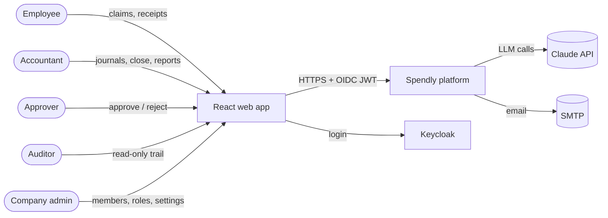
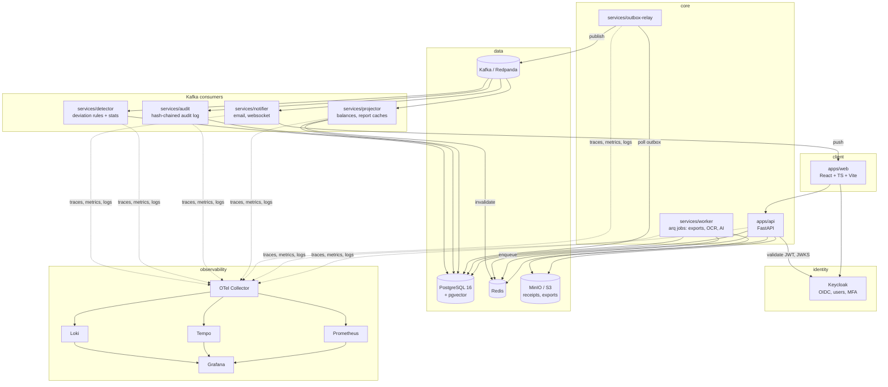

# Spendly — Architecture

Spendly is being rebuilt from a personal Flask expense tracker (tagged
`spendly-v1`) into a **multi-company corporate accounting platform** with
an AI advisor. This document is the target architecture. `docs/ROADMAP.md`
says what gets built when.

> Guiding rule: **code calculates, AI explains, a human decides.**
> Every number comes from the ledger through deterministic code. The AI
> only reads, explains and recommends; it never posts entries.

---

## 1. System context



## 2. Containers



| Component | Tech | Responsibility |
|---|---|---|
| `apps/web` | React 18, TypeScript, Vite, React Router, TanStack Query, Tailwind + shadcn/ui, Recharts, react-hook-form + zod | All UI. API client is **generated** from the FastAPI OpenAPI schema |
| `apps/api` | Python 3.12, FastAPI, Pydantic v2, SQLAlchemy 2 (async), Alembic | The only writer to the ledger. Validates, enforces permissions, writes rows **and** outbox events in one transaction |
| `services/outbox-relay` | Python | Moves committed outbox rows to Kafka (at-least-once) |
| `services/projector` | Python Kafka consumer | Maintains account balance projections; invalidates Redis report caches |
| `services/audit` | Python Kafka consumer | Append-only, hash-chained audit log |
| `services/detector` | Python Kafka consumer (pandas/numpy) | Deviation rules and statistical anomaly detection (Phase 4) |
| `services/notifier` | Python Kafka consumer | Email and websocket notifications (Phase 3) |
| `services/worker` | arq on Redis | Slow jobs: PDF/Excel exports, receipt extraction, AI runs |
| PostgreSQL 16 | + pgvector | System of record; row-level security per company |
| Redis 7 | | Cache, rate limits, distributed locks, job queue |
| Kafka | Redpanda locally (Kafka API compatible) | Domain event backbone |
| Keycloak | OIDC | Identity only (login, MFA, password reset). **Roles per company live in our DB** |
| MinIO | S3 API | Receipts and generated exports |
| OpenTelemetry + Prometheus + Tempo + Loki + Grafana | | Traces, metrics, logs; one trace from click → API → Kafka → consumer |

## 3. Repository layout (target)

```
spendly/
├── apps/
│   ├── api/                 # FastAPI service
│   │   ├── spendly/
│   │   │   ├── main.py      # app factory, middleware, routers
│   │   │   ├── config.py    # pydantic-settings, all config from env
│   │   │   ├── db/          # engine, session, RLS helpers, base model
│   │   │   ├── auth/        # JWT validation, current user, permissions
│   │   │   ├── modules/     # one package per domain module:
│   │   │   │   ├── companies/   #   models.py, schemas.py, service.py,
│   │   │   │   ├── ledger/      #   repository.py, router.py, events.py
│   │   │   │   ├── reports/
│   │   │   │   ├── spend/
│   │   │   │   ├── controls/
│   │   │   │   └── advisor/
│   │   │   └── outbox/      # outbox table + writer
│   │   ├── migrations/      # Alembic
│   │   └── tests/
│   └── web/                 # React app
│       └── src/{app,features,components,lib,api}
├── services/                # Kafka consumers and workers (share packages/py-common)
├── packages/
│   ├── py-common/           # event schemas, Kafka helpers, telemetry setup
│   └── events/              # JSON Schemas for every event (source of truth)
├── infra/
│   ├── compose/             # docker-compose.yml + per-service config
│   ├── keycloak/            # realm export (as code)
│   ├── grafana/             # provisioned dashboards
│   └── k8s/                 # Helm charts (later)
├── docs/                    # ARCHITECTURE.md, ROADMAP.md, adr/
├── .github/workflows/       # CI
└── Makefile                 # make up / down / test / lint / migrate / seed
```

Inside `apps/api`, each module keeps the same layering:

```
router.py      HTTP only: parse request, call service, shape response
service.py     business rules, transactions, permission checks
repository.py  SQL (SQLAlchemy Core/ORM), nothing else
models.py      tables
schemas.py     Pydantic request/response models
events.py      event payloads this module emits
```

## 4. Multi-company (multi-tenancy) model

- **Identity** (who you are) lives in Keycloak. **Membership** (which
  companies you belong to, and your role in each) lives in Postgres:

  ```
  users(id, keycloak_sub UNIQUE, email, name)
  companies(id, name, legal_name, gstin, pan, state_code,
            fiscal_year_start_month DEFAULT 4, base_currency DEFAULT 'INR')
  memberships(user_id, company_id, role, status)   -- PK (user_id, company_id)
  invitations(id, company_id, email, role, token_hash, expires_at)
  ```

- **Roles (per company):** `owner`, `admin`, `accountant`, `approver`,
  `employee`, `auditor`. Permissions are checked in `service.py`
  through one `require(permission)` helper, never ad-hoc in routers.
- **Isolation, in two layers:**
  1. Every company-owned table has `company_id NOT NULL`, and every
     query is scoped by it in the repository.
  2. **Postgres row-level security** as a backstop. The API connects as
     a non-owner role; each request transaction runs
     `SET LOCAL app.company_id = :id`, and every policy is
     `USING (company_id = current_setting('app.company_id')::bigint)`.
     A forgotten `WHERE` returns nothing instead of leaking another
     company's books.
- The active company comes from the URL (`/api/companies/{company_id}/…`)
  and is checked against the caller's membership on every request.

## 5. Ledger invariants (enforced in the database, not just in code)

| Invariant | Enforcement |
|---|---|
| Money is exact | `NUMERIC(18,2)` in Postgres, `Decimal` in Python, strings in JSON. **Never floats** |
| Every entry balances (Σ debit = Σ credit, ≥ 2 lines) | Deferred constraint trigger on `journal_lines`, checked at commit |
| A line is a debit **or** a credit | `CHECK ((debit > 0 AND credit = 0) OR (credit > 0 AND debit = 0))` |
| Posted entries are immutable | Trigger rejects UPDATE/DELETE on posted entries and their lines; corrections are **reversal entries** |
| Closed periods are locked | Trigger rejects posting into a `closed` fiscal period |
| Tamper evidence | Audit log rows carry `hash = sha256(prev_hash ‖ payload)` (Phase 4) |
| Lines use accounts of the same company | Composite foreign key `(company_id, account_id)` |

Account balances are **derived** from journal lines. The `account_balances`
projection (maintained from Kafka events) is a cache that can always be
rebuilt from the lines.

## 6. Events: the transactional outbox

Writing to Postgres and publishing to Kafka can't be one atomic step, so
the API never publishes directly:

```mermaid
sequenceDiagram
    participant W as Web
    participant A as API
    participant P as Postgres
    participant R as Outbox relay
    participant K as Kafka
    participant C as Consumers
    W->>A: POST /journal-entries
    A->>P: BEGIN; insert entry + lines; insert outbox row; COMMIT
    A-->>W: 201 Created
    R->>P: SELECT unsent outbox rows FOR UPDATE SKIP LOCKED
    R->>K: publish ledger.entry.posted (key = company_id)
    R->>P: mark sent
    K->>C: projector / audit / detector / notifier
```

- **Topics:** `ledger.entry.posted`, `ledger.entry.reversed`,
  `ledger.period.closed`, `spend.claim.submitted|approved|rejected|paid`,
  `controls.deviation.detected`, `advisor.recommendation.created`.
- **Key = `company_id`**, so one company's events stay in order.
- **Envelope:** `{event_id, type, version, company_id, occurred_at,
  actor_id, trace_id, payload}`. JSON Schemas live in `packages/events`.
- Delivery is at-least-once, so **every consumer is idempotent**
  (it records processed `event_id`s).

## 7. Caching (Redis)

| Key pattern | Holds | Invalidated by |
|---|---|---|
| `rpt:{company}:{report}:{params_hash}` | Rendered report JSON | projector on `ledger.entry.*` for that company |
| `rl:{user}:{route}` | Rate-limit counters | TTL |
| `lock:close:{company}:{period}` | Period-close lock | released on finish / TTL |
| `arq:*` | Job queue | arq |

Reports are always correct without Redis; Redis only makes them fast.

## 8. AI advisor (Phase 5)

- Claude API with **tool use**. Tools are thin wrappers over the same
  read-only service functions the reports use: `get_trial_balance`,
  `get_ratios`, `get_variance`, `get_ledger_lines`, `search_policy`.
- **No write tools.** Output is a *recommendation* row a human accepts
  or rejects.
- Expense policy documents are chunked and embedded into **pgvector**
  for `search_policy`.
- Every prompt, tool call, response, token count and cost is stored for
  audit. Runs have per-company budgets and rate limits.
- Receipt extraction (Phase 3) uses Claude vision; the extracted fields
  are a *draft* the employee confirms.

## 9. Security

- OIDC Authorization Code + PKCE in the browser; the API validates JWTs
  against Keycloak's JWKS (signature, `iss`, `aud`, `exp`).
- Authorization = membership role in the target company + RLS.
- Separation of duties: you can't approve your own claim or post and
  approve the same manual journal (Phase 3/4).
- All config and secrets from environment variables; `.env` is for local
  dev only and never committed; `.env.example` documents every variable.
- Uploads: size and MIME checks, stored under random keys, served via
  short-lived pre-signed URLs.
- Parameterized SQL only (SQLAlchemy); no string-built SQL.

## 10. Observability

- OpenTelemetry auto-instrumentation for FastAPI, SQLAlchemy, Redis,
  Kafka and fetch in the browser. `trace_id` travels inside the event
  envelope so a consumer's span joins the original request's trace.
- Structured JSON logs with `trace_id`, `company_id`, `user_id`.
- RED metrics per route, consumer lag per topic, outbox backlog size.

## 11. Testing strategy

| Level | Tools | What |
|---|---|---|
| Unit | pytest, Vitest | Pure functions: ratio maths, validation, sign flip |
| Integration | pytest + **testcontainers** (real Postgres, Redis, Redpanda) | Repositories, triggers, RLS, outbox → consumer |
| API | httpx AsyncClient against the app | Permissions, status codes, schemas |
| **Golden ledgers** | pytest | `workflows/03–05` (bakery, studio, NimbusSoft) posted end to end; every balance, report and ratio must match to the paisa |
| E2E | Playwright | Login → company → post entry → see balance sheet |
| AI | Recorded fixtures + eval suite | Advisor answers must cite only numbers returned by tools |

## 12. Environments and delivery

- **Local:** `make up` starts everything with Docker Compose.
- **CI:** GitHub Actions: ruff, mypy, eslint, tsc, unit + integration
  tests (service containers), Playwright, image builds.
- **Deploy target:** decided at the end of Phase 2 (Railway for the
  web/API with managed Postgres/Redis vs a VPS / Kubernetes with Helm for
  the full stack).

## 13. Architecture decisions

| # | Decision | Why |
|---|---|---|
| ADR-001 | Evolve the existing repo; Flask app frozen at tag `spendly-v1` | Keep history, specs and Claude tooling |
| ADR-002 | Multi-company with per-company roles in Postgres, identity in Keycloak | Realistic corporate model; one person can belong to several companies |
| ADR-003 | Modular monolith API + event consumers, not microservices | One writer to the ledger keeps invariants simple; consumers scale independently |
| ADR-004 | Transactional outbox → Kafka | Atomic "write + publish" without distributed transactions |
| ADR-005 | Postgres enforces ledger invariants (triggers, RLS) | The database is the last line of defence for money |
| ADR-006 | `NUMERIC(18,2)` + `Decimal` | Exact money |
| ADR-007 | India-first: April–March fiscal year, Schedule III, GST/TDS | Matches the domain examples in `workflows/` |
| ADR-008 | Redpanda for local Kafka | Kafka-compatible, single container, low memory |
| ADR-009 | AI is read-only and advisory | Auditability; humans own every posting |
